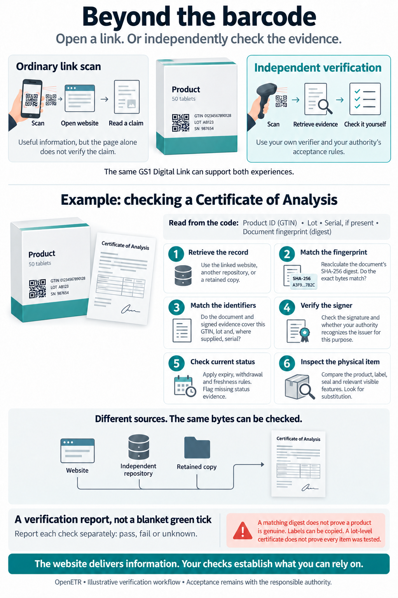

# Beyond The Barcode

*Independent verification for regulators and enforcement officers. October 14, 2026.*

## Policy Proposition

A barcode can identify a product at checkout or take a consumer to a website
experience. With product identifiers and a document digest, that same barcode
can also give an enforcement officer the information needed to retrieve and
verify supporting evidence independently, without trusting the linked website
or requiring it to be available. An independent repository or retained copy can
supply the evidence instead. These are different capabilities, even when they
begin with the same scan.

Opening a product page answers **what does this source say?** Independent
verification asks **does this exact record match the reference, who signed the
evidence, does it cover this product, and is it acceptable for this purpose?**

OpenETR supports that separation. A digest identifies exact artifact bytes;
signed events provide attributable evidence about those bytes. The responsible
authority applies its own recognition and acceptance rules. A website, relay,
repository, or retained file can supply evidence without becoming its exclusive
integrity authority.

**The website delivers information. Your checks establish what you can rely on.**

## The Verification Workflow

*Select the infographic to open the full-size image. Product identifiers and
barcodes are illustrative, not production labels. This is a conceptual workflow,
not a claim that every check is implemented or that an assurance level has been certified.*

The smartphone and dedicated scanner illustrate different experiences, not a
hardware requirement. An authority's smartphone application could perform the
independent workflow too. The difference is the software's checks and the
authority's rulebook, not the device used to acquire the code.

## One Scan And Different Questions

A GS1 Digital Link can carry a product identifier (GTIN), lot, and optional
serial number. OpenETR's digest extension adds a reference to exact digital
material. A consumer can open the HTTPS link with a compatible phone camera;
an authority's verifier can extract the fields without automatically visiting
the printed domain.

That verifier may obtain the same material from an independent repository or a
retained copy. It does not have to accept the website's presentation as proof.
Alternate retrieval still requires an available copy and a way to discover it:
a digest is neither storage nor an availability guarantee.

The barcode is a starting reference, not a trust anchor by itself. An attacker
could replace a label with a different digest and a different issuer's record.
Issuer recognition and inspection remain essential even when every byte matches.

## A Certificate Of Analysis Example

Consider a packaged product bearing a GTIN, lot number, and a digest referring
to a Certificate of Analysis. An officer's application should support distinct
checks rather than collapse everything into one green tick.

1. **Retrieve the record.** Obtain the certificate and related signed evidence
   from an available source. The printed website is one option, not the only one.
2. **Match the fingerprint.** Recompute SHA-256 over the certificate's exact
   bytes and compare it with the scanned digest. A visually similar document
   is not necessarily the same file.
3. **Match the identifiers and scope.** Check that the authenticated evidence
   covers the scanned GTIN and lot, and the serial if supplied. When the certificate
   itself is meant to contain those identifiers, check them inside the verified
   document as well. A lot-level certificate does not establish that each package
   was individually tested.
4. **Verify the signer and recognize the issuer.** Validate the signature and
   its binding to the digest and relevant identifiers. Separately determine
   whether the authority recognizes that key for this issuer and purpose.
   A key found in the scanned material is not automatically a trusted key.
5. **Check current acceptability.** Apply the relevant expiry, withdrawal,
   supersession, key-status, and freshness requirements. An original file can
   still match its digest after it ceases to be acceptable. Unavailable status
   evidence must be reported, not silently treated as confirmation.
6. **Inspect the physical item.** Compare the product, label, seal, and relevant
   visible features with the record. Look for substitution, overlays, or evidence
   of removal. Photographs can assist comparison but are not proof of provenance.

The report should identify each outcome as **pass, fail, or unknown**, retain
the evidence and relevant observation times, and identify the rules used.
The authority decides what those results mean for the inspection.

## What Verification Does Not Establish

| Check | What it supports | What remains separate |
| --- | --- | --- |
| Matching digest | The retrieved bytes match the scanned commitment. | Truth, authorship, current status, and physical authenticity. |
| Valid signature | The signed payload verifies under a particular key. | Recognition of the issuer, key compromise, and accuracy of claims. |
| Matching identifiers | The evidence covers the specified product class, lot, or instance. | Whether this label belongs on this physical item. |
| Recognized issuer | The authority accepts the key for a specified role and purpose. | Authority for other purposes or automatic acceptance of every claim. |
| Physical inspection | Observed features support the item's association with the label and record. | Guaranteed detection of copying, substitution, or tampering. |

## Physical Integrity And Product Association

Digital verification checks the record. Physical inspection asks a different
question: **does this barcode belong with the product being presented?** A copied
or substituted barcode can point to genuine, correctly signed evidence about
another product. The physical construction and placement of the code therefore
form part of the inspection design, not an incidental printing choice.

The appropriate protection depends on the purpose, handling environment, and
consequences of substitution. Not every use requires a security label.

### Printed On Packaging

A barcode printed directly on ordinary packaging may suffice when the purpose
is to retrieve product information or check a lot-level document and the
authority's procedure accepts that level of physical association. An officer
can compare the printed product identifiers, packaging, and visible features
with the verified record.

Direct printing avoids a separately attached label, but does not prevent copying
the package, overlaying the code, or replacing its contents. It supports an
association with the packaging; it does not independently establish the
authenticity of what is inside.

### Privately Revealed Barcodes

A code can be concealed beneath a scratch-off layer, inside a sealed package,
or behind another controlled-reveal feature. An authorized inspector or intended
recipient can expose it when needed. The condition of the covering or seal can
provide evidence of earlier access, depending on its design and inspection.

Concealment limits casual access before disclosure; it does not make the code
uncopyable or prove that nobody has seen it. Once revealed, it can be photographed
and reproduced. A private reveal is also not access control for the referenced
record: sensitive material still needs an explicit authorization and disclosure
design. The procedure should specify who may reveal the code and how opening or
damage is recorded.

### Secure Substrates And Tamper Evident Attachment

Where substitution poses a greater risk, the barcode can be printed on a secure
substrate and physically bound to the product or its enclosure. Possible designs
include destructible labels, attachments that leave visible evidence of removal,
or seals spanning an opening. Inspectable security features may help an officer
distinguish the intended material from an ordinary reproduction.

The substrate, attachment, and placement must work together. A secure label that
can be moved intact provides weak evidence of product association. A seal on an
outer carton may bind the code to that carton without binding it to every item
inside. The record and inspection instructions should state the intended scope:
product, package, lot, or individually identified unit.

These designs require testing against removal, reapplication, overlays, copying,
package opening, and normal wear. "Tamper-evident" means that specified forms of
interference can leave observable evidence under defined conditions, not that
tampering is impossible or always detectable. Photographs and recorded physical
features can assist inspection without replacing that testing.

**The digest binds the reference to exact digital material. Physical design and
inspection support the association between that reference and the actual item.**
Neither substitutes for the other. OpenETR does not prescribe a universal label
construction or certify physical security; the domain's rulebook determines the
required protection and how an officer handles a damaged, exposed, mismatched,
or uncertain label.

## Open Evidence And Explicit Authority

The proposed architecture permits independent issuers, repositories, and
verification applications. Open participation does not mean every issuer is
credible or every signed assertion is acceptable.

OpenETR supplies evidence that can be evaluated outside the originating
application. Domain rulebooks supply the meanings, required checks, recognized
issuers, and decision criteria. They also determine how to handle incomplete,
conflicting, or stale evidence. Semantic interoperability remains a domain
responsibility; a digest does not define what a laboratory result means.

In the current OpenETR convention, the artifact digest and the signed Nostr
event identifier are distinct. The barcode's digest extension identifies the
artifact bytes; an anchor event can bind that digest to signed product tags.
Such tags do not by themselves establish that the same identifiers appear
inside the artifact. Each verifier must check the association its use case requires.

## Conditions For Deployment

Authorities should specify the exact hashed object and signed payload, supported
formats, identifier scope, issuer recognition arrangements, and status requirements
before relying on a deployment. The workflow is not a substitute for these choices.

A practical pilot should verify the same record with two independent clients,
including retrieval from an alternate source. Tests should include an edited
file, mismatched lot, unrecognized signer, withdrawn record, unavailable evidence,
and a copied label. Results should show which checks fail or remain unknown,
not just whether a page loaded successfully.

Preservation and access arrangements matter too. A digest is not encryption;
public references can enable correlation, and predictable records may be guessed.
Sensitive identity or health records require a separate access and disclosure
design. The same separation of retrieval, verification, recognition, and physical
or holder checks can support other domains without making public disclosure mandatory.

**The policy opportunity is not to replace inspection with a scan. It is to give
inspectors portable evidence they can check with tools and rules they control.**

## Background And Further Reading

- [Verifiable Barcodes: An Independently Verifiable Architecture](https://docs.google.com/document/d/1lQk3BTQ-uWePBahajcPpq9GbDqbEa-cIYQT2rdDzDrM/edit): background concept note, October 14, 2026; access may require permission.
- [GS1 Digital Link and verifiable product information](gs1-digital-link-and-verifiable-product-information.md): multiple scanning experiences and trust models.
- [Product information design note](https://github.com/trbouma/openetr/blob/main/docs/specs/GS1_DIGITAL_LINK_CONTENT_ADDRESSED_PRODUCT_INFORMATION_DESIGN_NOTE.md): identifiers, content addressing, and signed associations.
- [Barcode acquisition and anchor discovery](https://github.com/trbouma/openetr/blob/main/docs/specs/GS1_BARCODE_ACQUISITION_AND_ANCHOR_DISCOVERY_SPEC.md): discovery when a scanned code supplies identifiers rather than a digest.
- [QR production and scratch-off considerations](https://github.com/trbouma/openetr/blob/main/docs/specs/OPENETR_QR_PRODUCTION_AND_SCRATCH_OFF_DESIGN_NOTE.md): physical label and scanning considerations.
- [OpenETR wire format](https://github.com/trbouma/openetr/blob/main/docs/specs/OPENETR_NOSTR_WIRE_FORMAT_SPEC.md): artifact digests, signed events, and structured tags.
